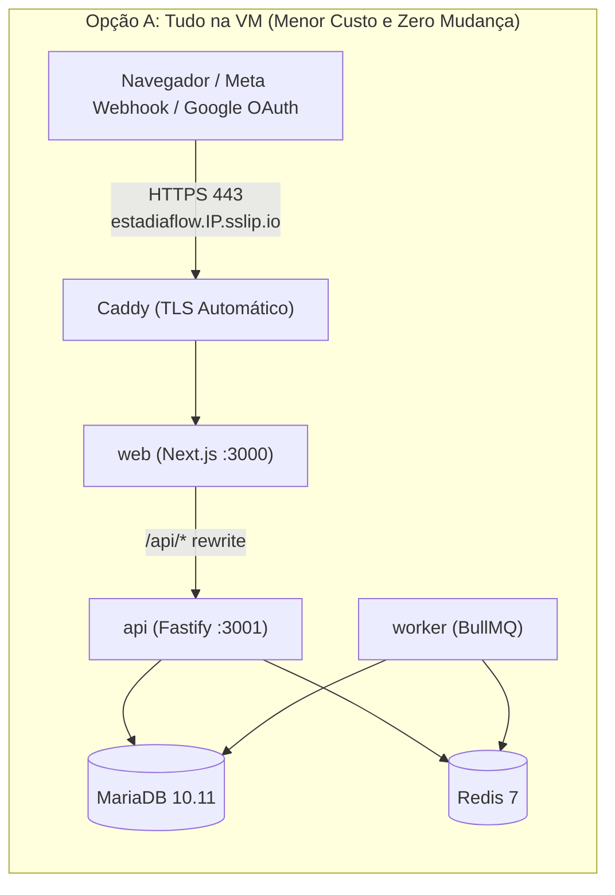

# Guia Passo a Passo: Credenciais e Deploy de Baixo Custo (MVP EstadiaFlow)

Este guia foi desenhado especificamente para a arquitetura do monorepo **EstadiaFlow** ([`docker-compose.yml`](file:///c:/Users/HOSTZAP/estadiaflow/docker-compose.yml), [`docker-compose.prod.yml`](file:///c:/Users/HOSTZAP/estadiaflow/docker-compose.prod.yml), [`Dockerfile`](file:///c:/Users/HOSTZAP/estadiaflow/Dockerfile) e [`apps/web/next.config.ts`](file:///c:/Users/HOSTZAP/estadiaflow/apps/web/next.config.ts)), considerando três premissas do seu cenário:
1. **Fase de validação de MVP com o menor custo possível** (aproveitando Free Tier / créditos do Google Cloud).
2. **Sem domínio próprio contratado no momento** (usando URL HTTPS gratuita automática).
3. **Projeto já criado no Google Cloud**.

---

## 1. Entendendo a Arquitetura do EstadiaFlow para Escolher o Menor Custo

O EstadiaFlow não é apenas um site Next.js; ele sobe **5 serviços integrados**:
- **`web` (`apps/web`)**: Painel em Next.js 16. Ele faz proxy reverso de `/api/*` para `API_INTERNAL_URL` ([`apps/web/next.config.ts`](file:///c:/Users/HOSTZAP/estadiaflow/apps/web/next.config.ts#L15-L17)) para que o cookie `hostops_session` (`httpOnly`, `SameSite=Lax`, `Secure`) funcione no mesmo domínio sem problemas de CORS.
- **`api` (`apps/api`)**: API Fastify + gravação de fotos de limpeza em disco (`STORAGE_DIR=/app/storage`).
- **`worker` (`apps/worker`)**: Processo BullMQ contínuo (sincroniza iCal a cada 15 min, Google Calendar a cada 10 min e responde WhatsApp com IA).
- **`mariadb`**: Banco MariaDB 10.11 (usa bloqueio transacional `SELECT ... FOR UPDATE` em `lockProperty`).
- **`redis`**: Fila Redis 7 (`maxmemory-policy noeviction`).

> [!IMPORTANT]
> **Por que não separar tudo em Cloud SQL + Memorystore + Cloud Run + Firebase App Hosting agora?**
> No Google Cloud, criar um Cloud SQL (~US\$ 15–25/mês) + Memorystore Redis (~US\$ 30/mês) + Cloud Run com CPU sempre alocada para o Worker (~US\$ 15/mês) custa **US\$ 60 a US\$ 90/mês** e ainda exigiria reescrever o adaptador de fotos (`LocalStorage` em [`packages/core/src/adapters/storage-local.ts`](file:///c:/Users/HOSTZAP/estadiaflow/packages/core/src/adapters/storage-local.ts)) para Cloud Storage.

### Comparativo das 2 Opções de Baixo Custo (Sem Domínio Próprio)

| Critério | Opção A (Recomendada): VM Única + Docker Compose + `sslip.io` | Opção B: Híbrida (Firebase App Hosting para `web` + VM para `api`/`worker`/DB) |
|---|---|---|
| **Alteração no código** | **Zero** (usa [`docker-compose.prod.yml`](file:///c:/Users/HOSTZAP/estadiaflow/docker-compose.prod.yml) e [`Caddyfile`](file:///c:/Users/HOSTZAP/estadiaflow/Caddyfile) prontos) | Requer configurar `apphosting.yaml` e expor a API da VM com HTTPS |
| **Domínio HTTPS gratuito** | `https://estadiaflow.<IP-DA-VM>.sslip.io` (certificado Let's Encrypt automático no Caddy) | `https://estadiaflow--<PROJETO>.us-central1.hosted.app` (gerado pelo Firebase) |
| **Custo mensal estimado** | **US\$ 0** (com créditos GCP ou `e2-micro` em `us-central1` + Swap) a **~US\$ 14/mês** (`e2-small`) | Mesmo custo da VM + franquia do Firebase App Hosting (Cloud Run + Cloud Build) |
| **Complexidade** | Baixa (1 lugar só para gerenciar `.env`, logs e backups) | Média (2 ambientes: Firebase para o Next.js e VM para API/Worker/MariaDB/Redis) |



---

## 2. Passo a Passo das Credenciais das APIs (Para o `.env`)

Todas as integrações externas do EstadiaFlow são **opcionais na subida inicial**: se uma chave ficar vazia, o recurso correspondente fica desligado sem quebrar o sistema ([`docs/INTEGRATIONS.md`](file:///c:/Users/HOSTZAP/estadiaflow/docs/INTEGRATIONS.md)). Você pode ativá-las uma por uma:

### 2.1. Segredos Obrigatórios da Aplicação (`JWT_SECRET` e `ENCRYPTION_KEY`)
Em produção (`NODE_ENV=production`), a API recusa iniciar se essas variáveis tiverem os valores de exemplo do [`.env.example`](file:///c:/Users/HOSTZAP/estadiaflow/.env.example).
- Gere os dois segredos no terminal (Linux/macOS/Git Bash ou na própria VM):
  ```bash
  # JWT_SECRET (mínimo 32 caracteres)
  openssl rand -base64 48

  # ENCRYPTION_KEY (exatos 32 bytes em base64 para AES-256-GCM)
  openssl rand -base64 32
  ```
- Para `MARIADB_ROOT_PASSWORD` e `MARIADB_PASSWORD`, crie senhas fortes usando **apenas letras e números** (evite `@`, `#`, `/`, `:` pois a senha é interpolada na `DATABASE_URL`).

### 2.2. Credencial do Google Gemini (`GEMINI_API_KEY`) — Custo Zero no Tier Gratuito
Usada pelo agente de IA para responder hóspedes no WhatsApp usando as ferramentas de [`packages/core/src/ai/tools.ts`](file:///c:/Users/HOSTZAP/estadiaflow/packages/core/src/ai/tools.ts).
1. Acesse o [Google AI Studio](https://aistudio.google.com/apikey) logado na sua conta Google.
2. Clique em **Create API Key** e selecione o **projeto do Google Cloud** que você já criou.
3. Copie a chave gerada e coloque em `GEMINI_API_KEY=` no `.env`.
4. Mantenha `GEMINI_MODEL=gemini-2.5-flash` (ou o modelo flash disponível na sua conta AI Studio).

### 2.3. Credencial do Google Calendar (`GOOGLE_CLIENT_ID` e `GOOGLE_CLIENT_SECRET`) — Custo Zero
Usada para sincronizar reservas, check-ins, check-outs e limpezas com uma agenda Google ([`docs/INTEGRATIONS.md`](file:///c:/Users/HOSTZAP/estadiaflow/docs/INTEGRATIONS.md#L91-L135)).
1. No [Google Cloud Console](https://console.cloud.google.com/), selecione o seu projeto.
2. Vá em **APIs e Serviços → Biblioteca**, procure por **Google Calendar API** e clique em **Ativar**.
3. Vá em **APIs e Serviços → Tela de permissão OAuth (OAuth consent screen)**:
   - Tipo de usuário: **Externo** (External).
   - Preencha nome do app (`EstadiaFlow`), e-mail de suporte e e-mail do desenvolvedor.
   - Em **Escopos (Scopes)**, adicione `https://www.googleapis.com/auth/calendar`.
   - Em **Usuários de teste (Test users)**, adicione o seu próprio e-mail do Google (enquanto o app estiver em modo "Testing", você não precisa passar pela verificação demorada do Google!).
4. Vá em **APIs e Serviços → Credenciais → + Criar credenciais → ID do cliente OAuth**:
   - Tipo de aplicativo: **Aplicativo da Web**.
   - Em **URIs de redirecionamento autorizados**, adicione a URL pública HTTPS do seu MVP seguida de `/api/v1/integrations/google/callback`:
     - Exemplo (Opção A com `sslip.io`): `https://estadiaflow.SEU_IP.sslip.io/api/v1/integrations/google/callback`
     - Exemplo (Opção B com Firebase App Hosting): `https://SUA_URL_FIREBASE.hosted.app/api/v1/integrations/google/callback`
5. Copie o **Client ID** e o **Client Secret** para `GOOGLE_CLIENT_ID` e `GOOGLE_CLIENT_SECRET` no `.env`.

### 2.4. Credencial do WhatsApp Business Cloud API (`WHATSAPP_APP_SECRET` e `WHATSAPP_VERIFY_TOKEN`) — Número de Teste Gratuito
1. Acesse [Meta for Developers](https://developers.facebook.com/) → **Meus Aplicativos → Criar Aplicativo**.
2. Escolha **Outro → Empresa (Business)** e conecte ao seu portfólio empresarial.
3. No painel do app, adicione o produto **WhatsApp**.
4. Vá em **Configurações do Aplicativo → Básico**:
   - Copie a **Chave Secreta do Aplicativo (App Secret)** e coloque em `WHATSAPP_APP_SECRET` no `.env`.
5. Invente uma senha aleatória (ex.: `estadiaflow_verify_2026_secreto`) e coloque em `WHATSAPP_VERIFY_TOKEN` no `.env`.
6. Vá em **WhatsApp → Configuração da API**:
   - A Meta fornece gratuitamente um **Número de telefone de teste**, um **`phone_number_id`** e um **Token de acesso** temporário (ou você pode criar um Usuário do Sistema no Business Manager para gerar um token permanente).
   - Esses dois dados (`phone_number_id` e `accessToken`) **não vão no `.env`**: você os cadastra direto na tela **Configurações** dentro do painel do EstadiaFlow após fazer login!
7. Quando o servidor já estiver no ar com HTTPS, volte em **WhatsApp → Configuração → Webhook** na Meta:
   - **URL de callback**: `https://<SEU_ENDERECO_HTTPS>/api/v1/webhooks/whatsapp`
   - **Verificar token**: o mesmo valor que você colocou em `WHATSAPP_VERIFY_TOKEN`.
   - Clique em **Verificar e salvar** e assine o campo **`messages`**.

---

## 3. Roteiro Principal (Opção A): Deploy de Menor Custo em VM Única + HTTPS Gratuito (Sem Domínio)

Esta é a forma mais barata, rápida e 100% compatível com o código atual ([`docs/DEPLOY_GCP.md`](file:///c:/Users/HOSTZAP/estadiaflow/docs/DEPLOY_GCP.md)).

### Passo 3.1 — Criar a VM e o IP Estático no Google Cloud

> [!TIP]
> **Dica de custo para MVP**:
> - Se você tem os **US\$ 300 de crédito gratuito** do Google Cloud, use `e2-medium` (2 vCPUs, 4 GB RAM) em `southamerica-east1` (São Paulo) para que o build do Next.js rode rápido. Depois do primeiro build, você pode reduzir a máquina para `e2-small` (2 GB RAM, ~US\$ 13/mês) ou `e2-micro` (1 GB RAM + 2 GB de Swap).
> - Se quiser usar o **Always Free Tier** do GCP (US\$ 0/mês mesmo sem créditos), crie uma `e2-micro` na região `us-central1` com disco Standard (`pd-standard`) de 30 GB e ative 2 GB de arquivo de Swap antes do build.

Comandos `gcloud` (substitua `SEU_PROJECT_ID` pelo ID do projeto que você criou):

```bash
gcloud config set project SEU_PROJECT_ID
gcloud services enable compute.googleapis.com

# 1. Reservar IP estático
gcloud compute addresses create estadiaflow-ip --region=southamerica-east1

# 2. Mostrar o IP reservado (anote este número, ex: 34.95.120.10)
gcloud compute addresses describe estadiaflow-ip --region=southamerica-east1 --format='value(address)'

# 3. Criar a VM Debian 12
gcloud compute instances create estadiaflow-vm \
  --zone=southamerica-east1-b \
  --machine-type=e2-medium \
  --image-family=debian-12 --image-project=debian-cloud \
  --boot-disk-size=30GB \
  --address=estadiaflow-ip \
  --tags=estadiaflow-web

# 4. Liberar apenas HTTP (80) e HTTPS (443) para o Caddy
gcloud compute firewall-rules create estadiaflow-allow-web \
  --allow=tcp:80,tcp:443,udp:443 \
  --target-tags=estadiaflow-web
```

### Passo 3.2 — Definir seu Domínio HTTPS Gratuito com `sslip.io` (Sem Comprar Domínio)

Como você ainda não tem domínio próprio, mas precisa de **HTTPS válido** (obrigatório para o cookie `Secure`, para o webhook da Meta e para o callback OAuth do Google):
1. Pegue o IP estático retornado no passo anterior (exemplo: `34.95.120.10`).
2. Seu domínio gratuito será:
   ```text
   estadiaflow.34.95.120.10.sslip.io
   ```
   *(O serviço público `sslip.io` resolve automaticamente qualquer subdomínio contendo um IP para aquele próprio IP, e o Caddy dentro do nosso `docker-compose.prod.yml` emite um certificado Let's Encrypt real para ele automaticamente!)*

### Passo 3.3 — Instalar Docker e Enviar o Código para a VM

Conecte-se à VM:
```bash
gcloud compute ssh estadiaflow-vm --zone=southamerica-east1-b
```

Na VM, instale o Docker e crie 2 GB de Swap (evita falta de memória durante o build do Next.js):
```bash
# Criar 2 GB de swap por segurança
sudo fallocate -l 2G /swapfile && sudo chmod 600 /swapfile && sudo mkswap /swapfile && sudo swapon /swapfile
echo '/swapfile none swap sw 0 0' | sudo tee -a /etc/fstab

# Instalar Docker e Docker Compose
curl -fsSL https://get.docker.com | sudo sh
sudo usermod -aG docker $USER
exit
```

Reconecte por SSH (`gcloud compute ssh estadiaflow-vm --zone=southamerica-east1-b`) e clone seu repositório Git (ou envie o `.zip` gerado por `pnpm package`).

### Passo 3.4 — Configurar o `.env` na VM

Dentro da pasta do projeto na VM:
```bash
cp .env.example .env
nano .env
chmod 600 .env
```

Preencha os campos principais usando o domínio `sslip.io` do seu IP (exemplo para IP `34.95.120.10`):
```dotenv
NODE_ENV=production
DOMAIN=estadiaflow.34.95.120.10.sslip.io
WEB_URL=https://estadiaflow.34.95.120.10.sslip.io

MARIADB_ROOT_PASSWORD=UmaSenhaRootForteSoLetrasENumeros2026
MARIADB_DATABASE=EstadiaFlow
MARIADB_USER=EstadiaFlow
MARIADB_PASSWORD=UmaSenhaAppForteSoLetrasENumeros2026

JWT_SECRET=<resultado_do_openssl_rand_base64_48>
ENCRYPTION_KEY=<resultado_do_openssl_rand_base64_32>

GEMINI_API_KEY=<sua_chave_ai_studio_ou_vazio>
GEMINI_MODEL=gemini-2.5-flash

WHATSAPP_APP_SECRET=<seu_app_secret_meta_ou_vazio>
WHATSAPP_VERIFY_TOKEN=<seu_token_verificacao_ou_vazio>

GOOGLE_CLIENT_ID=<seu_client_id_ou_vazio>
GOOGLE_CLIENT_SECRET=<seu_client_secret_ou_vazio>
GOOGLE_REDIRECT_URI=https://estadiaflow.34.95.120.10.sslip.io/api/v1/integrations/google/callback
```

### Passo 3.5 — Subir em Produção e Criar seu Usuário Proprietário

1. Fixe os arquivos do Compose de produção e suba os contêineres:
   ```bash
   echo 'export COMPOSE_FILE=docker-compose.yml:docker-compose.prod.yml' >> ~/.bashrc
   source ~/.bashrc

   docker compose up -d --build
   docker compose logs -f migrate api worker caddy
   ```
2. Crie sua organização real e seu usuário proprietário (pois em produção o seed de demonstração não é executado):
   ```bash
   read -s -p "Senha do proprietário (mín. 10 caracteres com letras e números): " OWNER_PASSWORD && export OWNER_PASSWORD && echo

   docker compose run --rm \
     -e ORG_NAME="Minha Hospedagem MVP" \
     -e OWNER_NAME="Seu Nome" \
     -e OWNER_EMAIL="seuemail@exemplo.com" \
     -e OWNER_PASSWORD \
     migrate ./node_modules/.bin/tsx src/create-owner.ts

   unset OWNER_PASSWORD
   ```
   *(Se você preferir subir o ambiente de testes já populado com os dados fictícios de demonstração `owner@estadiaflow.demo`, basta rodar `docker compose run --rm migrate ./node_modules/.bin/tsx src/seed.ts`.)*
3. Acesse `https://estadiaflow.SEU_IP.sslip.io` no navegador!

---

## 4. E se você quiser usar o Firebase Hosting / App Hosting?

Se você quiser que o usuário acesse uma URL `https://seu-projeto.web.app` ou `https://...hosted.app` do **Firebase** em vez de `sslip.io`, existem duas formas de integrar com a estrutura atual do projeto:

### 4.1. Usar o Firebase App Hosting para rodar o `apps/web` (Next.js)
O Firebase App Hosting constrói e roda o Next.js no Cloud Run automaticamente a partir do GitHub:
1. No console do [Firebase](https://console.firebase.google.com/), clique em **Add project** e selecione o **projeto Google Cloud que você já criou**.
2. Ative o plano **Blaze (Pay as you go)** (necessário para o App Hosting, que tem franquia gratuita mensal).
3. Em **Build → App Hosting**, conecte seu repositório GitHub:
   - **Root directory**: `/` (raiz do monorepo, para que o `pnpm` enxergue `packages/shared`).
   - Adicione um arquivo `apphosting.yaml` na raiz configurando as variáveis de build e runtime do Next.js:
     ```yaml
     runConfig:
       minInstances: 0
       maxInstances: 2
       cpu: 1
       memoryMiB: 512
     env:
       - variable: API_INTERNAL_URL
         value: https://estadiaflow.<IP_DA_VM>.sslip.io
         availability:
           - BUILD
           - RUNTIME
       - variable: WEB_URL
         value: https://<SEU_BACKEND>--<SEU_PROJETO>.us-central1.hosted.app
         availability:
           - BUILD
           - RUNTIME
     ```
4. Na VM (onde rodam `api`, `worker`, `mariadb` e `redis`), defina `WEB_URL=https://<SEU_BACKEND>--<SEU_PROJETO>.us-central1.hosted.app` para que a verificação de CSRF/CORS em [`apps/api/src/app.ts`](file:///c:/Users/HOSTZAP/estadiaflow/apps/api/src/app.ts#L65-L86) aceite as requisições vindas do domínio do Firebase.

> [!NOTE]
> Como a Opção A já roda o Next.js (`web`) dentro da própria VM junto com a API, o Worker, o MariaDB e o Redis sem custo extra, **começar pela Opção A (100% na VM)** evita ter que manter dois deploys sincronizados (Firebase + VM) durante a validação do MVP. Quando vocês comprarem o domínio definitivo (`.com.br`), basta apontar o registro `A` do domínio para o IP da VM e trocar `DOMAIN` e `WEB_URL` no `.env`!
